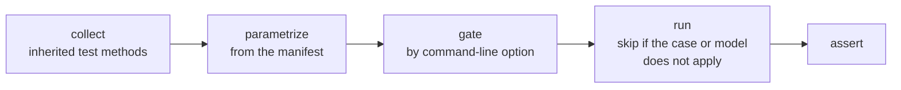

# How the plugin tests work

A model plugin gets its tests from `atomforge-testing`. The plugin writes one
short class per model, and pytest turns it into a few dozen tests that check the
plugin is wired the way atomforge expects, that its environment resolves, that
the model runs, that its results obey basic physics, and that they have not
changed since they were recorded.

This page explains how that happens: what the class gives you, where each test
comes from, and why a test runs, is skipped or fails. For the steps to set up the
tests in a new plugin, see [Testing a model plugin](plugin-testing.md).

## The class you write

This is the test class of the model plugin template (`templates/model-plugin`):

```python
class TestTorchLJ(ModelPluginContract):  # (1)!
    manifest_case = ModelManifestCase(  # (2)!
        manifest=torch_lj_manifest,  # (3)!
        entry_point_name="torch_lj",  # (4)!
        entry_point_package="atomforge-template",
        pyproject_path=PYPROJECT,
        expected_entry_point_target="atomforge_template.manifest:torch_lj_manifest",
        model_spec_factory=torch_lj_spec_factory,  # (5)!
        runtime_structure=structures.small_molecule(),  # (6)!
        runtime_exec_resources=ExecutionResources(accelerator="cpu", precision="f32"),  # (7)!
        physics_structures={"molecule": structures.ethanol()},  # (8)!
        local_weights_factory=torch_lj_local_weights,  # (9)!
    )
```

1.  `ModelPluginContract` contains no tests of its own. It inherits from ten
    *contracts*, classes of test methods that know nothing about any particular
    model. Pytest collects inherited `test_*` methods, so `TestTorchLJ` gets all
    of them.
2.  The *case*: everything the contracts need to know about this model. Each
    test method reads it as `self.case`. It is a dataclass, so a misspelt field
    name fails when pytest imports the test module.
3.  The model's `ModelManifest`. Most tests are driven by what it declares: its
    supported properties, resource capabilities and environment profiles decide
    which tests exist (see [Parametrization](#tests-made-from-your-declarations)).
4.  The entry point the plugin registers in its `pyproject.toml`, the
    distribution that provides it and the `module:attr` it must point at. The
    manifest and registry contracts check that these agree with each other and
    with the installed package.
5.  A function that receives the model's spec class and returns one valid,
    representative spec. Every test that needs a spec, including every model
    run, uses this one. The default calls the class with no arguments.
6.  The structure for the basic runtime tests (`small_molecule()` by default).
    A test of stress uses `structures.periodic_bulk()` instead when this
    structure is not periodic.
7.  The resources for the runtime, physics and reference tests (CPU and f32 by
    default).
8.  The structures for the physics checks and the reference values. By default
    they are all three reference structures, a molecule, a slab and a bulk
    crystal; this model only handles non-periodic systems, so it keeps the
    molecule, and the tests on the slab and bulk are skipped.
9.  The spec declares `weights`, so the case gives a function that writes the
    variant's own parameters as local weights (see the local weights row
    below).

Five fields are not used here: `variants` names the variants the runtime,
physics and reference tests run, by variant name, with the settings of the
factory's spec (by default the factory's spec only; `--atomforge-all-variants`
runs every generated variant). The other four: `runtime_skip_reason` skips every test that
runs the model, with that reason; `physics` declares physical properties the
model does not have (see [Skips](#why-a-test-is-skipped)); `tolerances` replaces
the physics checks' default tolerances for a precision; and
`reference_tolerances` replaces those of the reference comparison.

## What it gives

For the template, the class collects 168 tests. They come from the ten
contracts; the template's spec has two environment profiles, `tested` and
`latest`, and every contract that builds or runs the model does so once per
profile:

| Contract | Tests for the template | What it checks | Needs |
|---|---|---|---|
| `ModelManifestContract` | 4 | the manifest is a `ModelManifest`; the `pyproject.toml` entry point targets it; it converts to a registration and every path in it loads | |
| `ModelManifestSymbolContract` | 8 | each symbol the manifest names loads and has the right type (spec, executor, properties, environment factory, metadata, resource capabilities, optional probe and task overrides) | |
| `ModelSpecContract` | 12 | the factory's spec has the manifest's `kind`, survives a round trip through Python and JSON (specs reach the worker as JSON), defaults to the `tested` profile and rejects an unknown one; the spec generates variants with unique names that survive JSON, the factory's spec is one of them, and `variant_info`, if given, covers every variant with distinct checkpoints | |
| `ModelRegistryContract` | 4 | the installed package is found by `ModelRegistry.default()`, with the same kind, source and spec class | |
| `ModelEnvironmentContract` | 6 × 2 profiles | the environment factory builds an `EnvironmentSpec`, the same one twice, and only from requirements, Python and channels its `DependencySummary` declares | |
| `ModelEnvironmentResolutionContract` | 1 × 2 profiles | the environment provider (uv) resolves that environment | `--atomforge-environment` |
| `ModelSinglePointRuntimeContract` | (2 properties + 5 resource pairs) × 2 profiles | each declared property comes back finite and in the right shape; each declared accelerator and precision runs with `strict=True` | `--atomforge-runtime` (CUDA, ROCm, MPS: also `--atomforge-cuda`, `--atomforge-rocm`, `--atomforge-mps`) |
| `ModelPhysicsContract` | 16 × 2 profiles | rigid-motion invariance, zero net force, forces against the energy gradient, repeatability, per-atom energies and symmetric stress | `--atomforge-runtime` |
| `ModelReferenceContract` | 3 structures × 2 profiles | energy, forces and stress match the references stored with the plugin's tests (see [Reference values](#reference-values)) | `--atomforge-runtime` and the `regression` extra |
| `ModelLocalWeightsContract` | 2, only when the spec declares `weights` | the variant's own parameters, written by the case's `local_weights_factory` and loaded as `LocalWeights`, give the variant's results within the reference tolerances; weights whose recorded hash no longer matches their contents are rejected | `--atomforge-runtime` |

The first five contracts only import the plugin; they run in a second, with a
plain `uv run pytest`. The last five create the model's environment or run the
model, and are switched on by command-line options (see [Gates](#gates)).

## How a class becomes tests

Pytest builds the tests in three steps before it runs any of them, and the test
itself can still decide to skip:



All of it is done by the pytest plugin that `atomforge-testing` installs
(`atomforge_testing/plugin.py`, registered through the `pytest11` entry point).
Installing the package is enough: there is nothing to add to `conftest.py` or
the pytest configuration.

### Tests made from your declarations

Some test methods take an argument named after a declaration. When pytest
collects such a method on a class with a `manifest_case`, the plugin's
`pytest_generate_tests` hook loads the declaration from the manifest and makes
one test per value:

| Argument | Values from the manifest | For the template |
|---|---|---|
| `atomforge_environment_profile` | the values of the spec's `environment_profile` `Literal`, or only `tested` | `tested`, `latest` |
| `atomforge_declared_property` | the supported properties | `energy`, `forces` |
| `atomforge_declared_resources` | each declared accelerator with each precision declared for it; a knob set to `None` gives `default` | `cpu-f32`, `cpu-f64`, `cuda-f32`, `cuda-f64`, `mps-f32` |

Every test that builds or runs the model takes the profile, so a test made
from two declarations gets both in its id, the profile first:
`test_declared_property_is_returned[latest-forces]` is the test that requests
forces alone, with the `latest` profile. Declaring a new property, precision
or profile therefore adds tests by itself, and a plugin cannot leave a
declaration untested.

The declarations are loaded at collection time. If one cannot be loaded (a
wrong `module:attr` path, an import error), its tests become a single skipped
test with id `[unloadable]` and the error as the reason, and the symbol contract
reports the error as a failure.

The physics checks and the reference test are also parametrized by structure
name, which is fixed in the contract rather than read from the manifest and
follows the profile in the id (`[tested-bulk]`). Each check lists the
reference structures it applies to: translation, the gradient, repeatability,
per-atom energies and the reference values on all three (`molecule`, `slab`,
`bulk`), rotation and net force on the molecule only (the rotation turns the
atoms but not the cell, so it is only rigid without periodic boundaries), and
stress symmetry on the two periodic structures.

### Gates

Creating an environment or running a model takes from seconds to many minutes,
so those tests are off unless asked for. Each such test method carries a
marker, and the plugin skips every marked test whose option is not given:

| Marker | Option | Used by |
|---|---|---|
| `atomforge_environment` | `--atomforge-environment` | environment resolution |
| `atomforge_runtime` | `--atomforge-runtime` | the single-point, physics, reference and local weights contracts |
| `atomforge_cuda` | `--atomforge-cuda` | resource pairs on `cuda` (NVIDIA GPUs) |
| `atomforge_rocm` | `--atomforge-rocm` | resource pairs on `rocm` (AMD GPUs) |
| `atomforge_mps` | `--atomforge-mps` | resource pairs on `mps` (Apple silicon) |

The accelerator markers are added to individual parameters, so
`[tested-cpu-f32]` runs on any machine while `[tested-cuda-f32]` waits for both
`--atomforge-runtime` and `--atomforge-cuda`. The options are the only switch:
a marker given to `-m` selects tests but does not enable them.

```bash
uv run pytest                                          # wiring only
uv run pytest --atomforge-environment --atomforge-runtime   # everything this machine can run
uv run pytest --atomforge-runtime -k "gradient and tested-bulk"   # one check, one profile, one structure
```

### Why a test is skipped

A test that passed the gate can still skip itself when it starts, because the
check does not apply. The reason is in the skip message (`pytest -rs` lists
them). Running the template with both options gives 55 passed and 31 skipped:

| Skip reason | Tests | Why |
|---|---|---|
| `pass --atomforge-cuda to run` | 4 | gated (the CUDA pairs, for both profiles) |
| `pass --atomforge-mps to run` | 2 | gated (the MPS pair, for both profiles) |
| `torch-lj does not declare energies` | 6 | the per-atom energy check needs a property the model does not declare |
| `torch-lj does not declare stress` | 4 | likewise for stress symmetry |
| `the case has no slab physics structure` | 8 | `physics_structures` left the slab out (physics and reference tests) |
| `the case has no bulk physics structure` | 8 | likewise for bulk |
| `manifest does not declare task override executors` | 1 | nothing to check |

A physics check can also skip because the case declares that the model lacks a
physical property the check relies on. These are declared with `ModelPhysics`,
in which every property is claimed by default:

```python
physics=ModelPhysics(conservative_forces=False, rotation_invariant=False)
```

| Declared absent | Checks skipped |
|---|---|
| `conservative_forces` | forces against the energy gradient, zero net force, symmetric stress |
| `translation_invariant` | translation invariance, zero net force |
| `rotation_invariant` | rotation invariance, symmetric stress |

The skip then reads `the case declares ModelPhysics(rotation_invariant=False)`.
A check is skipped for one reason only, tried in this order: the declared
physics, the declared properties, then the physics structures.

A skip is the contracts saying "this does not apply", not "this is broken":
nothing that fails is turned into a skip. A declaration that is wrong the other
way, a property claimed that the model does not have, shows up as a failure.

## How a test runs the model

The runtime, physics and reference tests run the model the way a user would.
Each run builds a `SinglePoint` task for the structure and the requested
properties, takes the spec from `model_spec_factory` with the test's profile,
and calls `backend.execute(task, model=spec, exec_resources=resources)`.

The backend comes from the `atomforge_backend` fixture: one `SubprocessBackend`
for the whole pytest session, shut down at the end. The first run creates the
model's environment and starts a worker, which can take minutes; the following
runs reuse both. Your own runtime tests can use the same fixture (mark them
`@pytest.mark.atomforge_runtime`), and a `conftest.py` can override it to run
the contracts on another backend.

The resources are the case's `runtime_exec_resources`, except in three
places: `test_declared_resources_execute_strictly` uses each declared
combination with `strict=True`, so the run fails instead of falling back to
another accelerator or precision; the gradient check uses f64 when the model
declares it, so the finite difference is not drowned in rounding; and a
reference is recorded on CPU at the highest declared precision.

## How the physics checks decide

A physics check compares a deviation with a tolerance, for example the change
in energy per atom after a rigid translation. The deviation functions are in
`atomforge_testing.physics`, and the tolerances depend on the precision the
model ran at: `DEFAULT_TOLERANCES` holds an `f32` and an `f64` set, and a model
that does not use the precision knob (`default`) gets the looser `f32` set. The
values were measured on the existing plugins; the method and data are in the
workspace research post "Default tolerances for the atomforge-testing physics
checks". A case replaces a set with
`tolerances={"f32": Tolerances(...)}`.

The gradient check needs one more decision. It displaces an atom by a small
step in each direction, and compares the force with minus the change in energy
over the step, for the three largest force components. If the forces are tiny,
a force with the wrong sign would also pass, so the check fails as
*uninformative* when the largest component is below ten times its tolerance.
The fix is a physics structure with larger forces, not a looser tolerance.

The failure messages give the structure, the deviation and the tolerance, so a
failing physics check says how far off the model was:

```text
energy of the molecule changed by 0.000721 eV/atom under a rigid rotation (tolerance 1e-05)
```

## Reference values

The reference test compares a model's results with values stored next to the
plugin's tests, so that a change in a dependency, or a new `latest`
environment, that changes the model's numbers is noticed. It uses
[pytest-regressions](https://pytest-regressions.readthedocs.io/)'
`ndarrays_regression`, installed with the `regression` extra
(`atomforge-testing[runtime,regression]`); without it, the reference tests
fail with a message that names the extra.

**What is stored.** One file per variant and structure,
`<kind>-<variant>-<structure>.npz` (`torch-lj-default-molecule.npz`), in a
directory named after the test module (`tests/test_contracts/` for the
template). It holds the energy per atom and the forces, and the stress when
the model declares it and the structure is periodic. Naming the file after
the kind and the variant keeps two models, or two variants of one, in one
test module apart.

**Recording.** A missing reference fails the `[tested-…]` test, which runs
the model on CPU with the `tested` profile at the highest declared precision
and writes the file; commit it. After an intended change, rerun with
`--force-regen` (rewrites references that differ, and fails so that the change
is seen) or `--regen-all` (rewrites every reference). Only the `tested`
profile records: a `[latest-…]` test with no reference fails and names the
test that records it, and is skipped while references are regenerated.

**Comparing.** Every profile runs the model with the case's resources and
compares with the same reference, so `[latest-…]` is the check that the
newest dependencies still give the recorded numbers. The tolerances are
absolute (`REFERENCE_TOLERANCES` in `atomforge_testing.physics`, one set for
every precision, since a reference recorded in f64 is compared with f32 runs
and on other machines); a case replaces them with
`reference_tolerances=ReferenceTolerances(...)`. A failure lists the values
that differ.

## Using only some contracts

`ModelPluginContract` is a convenience. A plugin can inherit from the
contracts it wants instead, for example to leave out the physics checks while
a model is being brought up:

```python
class TestMyModel(
    ModelManifestContract,
    ModelSpecContract,
    ModelSinglePointRuntimeContract,
):
    manifest_case = ModelManifestCase(...)
```

Mark your own test methods rather than a class that others inherit from:
pytest collects class markers through inheritance, so a marker on a base class
would gate every test of every class built on it.
